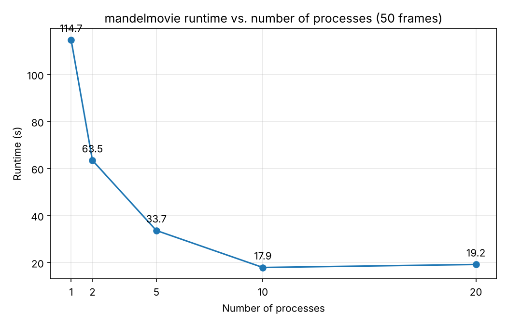

# CPE-2600 Lab 11 - Multiprocessing (mandelmovie)

Name: Konrad Swierczek
Section: 111

## Implementation overview

`mandelmovie` is a new program that leaves the provided `mandel` program unchanged. It takes the number of child processes on the command line (`-p`), interpreted with `getopt`. Optional flags (`-n`, `-x`, `-y`, `-a`, `-b`, `-W`, `-H`, `-m`) change the frame count, zoom center, start and end scale, image size and max iterations. Run `./mandelmovie -h` for the full list.

For each of the 50 frames, the parent computes a scale that shrinks exponentially from 4 down to 0.0005, which gives a smooth zoom into the point x=0.286932, y=0.014287. It then calls `fork()`, and the child replaces itself with `mandel` using `execv()` to write `mandel<N>.jpg`. The parent never lets more than `-p` children run at once: when the limit is reached it calls `wait()` for one child to finish before starting the next frame. After the last frame is launched, the parent waits for all remaining children before exiting. Each child works independently, so no pipes are needed.

The frames are stitched into a movie with:

    ffmpeg -i mandel%d.jpg mandel.mpg

The finished movie is included in this repo as `mandelmovie.mpg`.

## Runtime results

Each run generated 50 frames (1000x1000 pixels, 1000 max iterations) on a machine with 14 logical processors.

| Processes | Time (s) | Speedup vs. 1 process |
|-----------|----------|-----------------------|
| 1  | 114.71 | 1.00x |
| 2  | 63.49  | 1.81x |
| 5  | 33.65  | 3.41x |
| 10 | 17.92  | 6.40x |
| 20 | 19.20  | 5.98x |

## Discussion

More processes sped up the program, but not without limit. Going from 1 to 10 processes cut the runtime from 114.7 s to 17.9 s, a speedup of about 6.4x. Going to 20 processes did not help: it was slightly slower, at 19.2 s.

The speedup is close to proportional at first (1.8x with 2 processes), then falls further below ideal as processes are added (3.4x with 5, 6.4x with 10). Several things limit it. Work per frame is uneven, because the deeper zoom frames need more iterations, so some processes finish early and sit idle near the end. Some of the 14 logical processors may also share physical cores, so they are not fully independent.

Past the number of logical processors (14), extra processes cannot run in parallel. With 20 processes, the children take turns on the same cores, which adds context-switching overhead and no extra computing power. That is why 20 processes was slightly slower than 10. Using more processes therefore does not always speed up the operation: the benefit levels off once the processes outnumber the available cores.

## Build and run

    make
    ./mandelmovie -p 5
    ./timing.sh
    make movie
